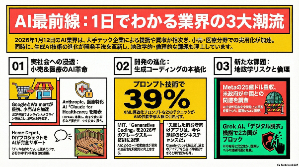

# 🍌 Nano Banana Prompt Gallery（v1）

Nano Banana Pro で使える、インフォグラフィック向けプロンプトを紹介するギャラリーサイトの初版（v1）です。気になるデザインの画像を見て、プロンプトをコピーしてそのまま使えます。



👉 後継版はこちら：[v2](https://github.com/tetumemo/nano-banana-prompt-gallery-v2) / [v3](https://github.com/tetumemo/nano-banana-prompt-gallery-v3)（v3はプロンプト70種）

## 特徴

- デザインパターンごとに、生成画像とプロンプトをカード形式で掲載
- プロンプトは `prompts.js` のデータから表示され、コピーして使える
- HTML / CSS / Vanilla JavaScript だけで動く軽量な静的サイト

## 中身

```text
nano-banana-prompt-gallery/
├── index.html    # メインページ
├── style.css     # スタイル
├── script.js     # 表示・操作のロジック
├── prompts.js    # プロンプトデータ
├── images/       # ギャラリー用画像（image1.png 〜 image10.png）
├── parse_md.py   # プロンプト集Markdownの取り込み補助
└── 【Manus用】Nano Banana Pro_インフォグラフィックプロンプト集.md  # 元のプロンプト集
```

## 使い方

1. `index.html` をブラウザで開く（または静的ホスティングに置く）
2. 気になるデザインのカードを探す
3. プロンプトをコピーして、自分のAI画像生成ツールに貼って実行する

## ライセンスと著作権

© tetumemo

掲載されているプロンプトおよび生成画像の権利は各作成者に帰属します。
